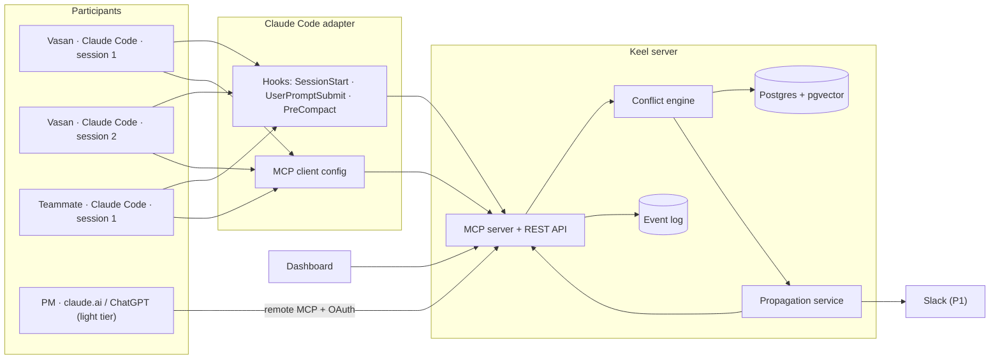
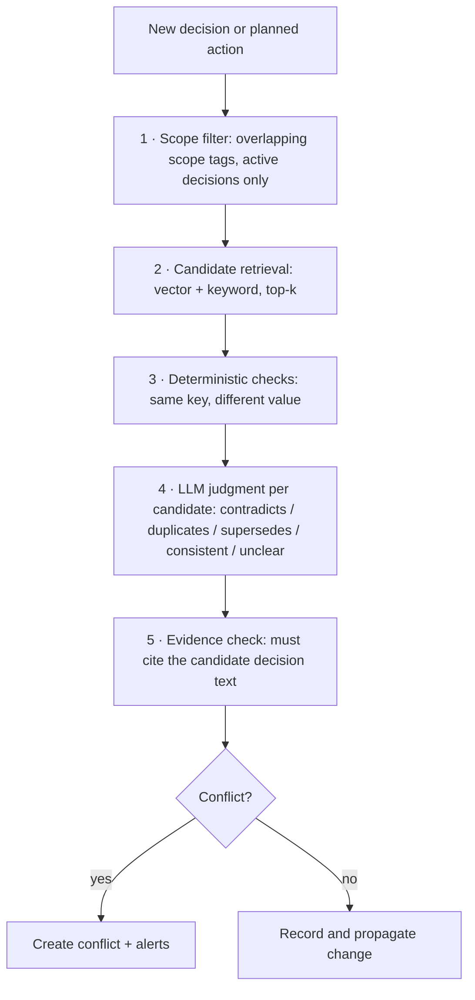
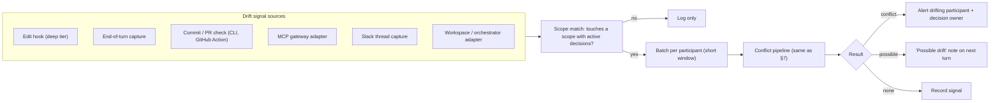
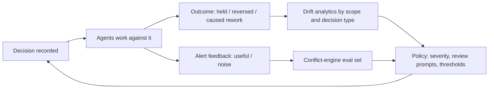
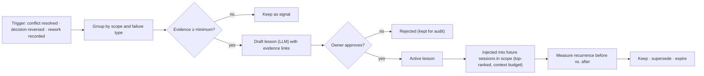

# Architecture — Keel (working name)

**Version:** 1.0 (final draft for team review) · **Last updated:** 2026-10-05

---

## 1. Design principles

1. **Harness-agnostic core.** Claude Code is the first adapter, not a dependency of the engine.
2. **Same primitives at every scope.** Session-to-session and team-to-team conflicts use the same model.
3. **Humans resolve; Keel flags.** No automatic overwrites of decisions or code.
4. **Evidence or silence.** Every conflict cites the decision it conflicts with.
5. **Fail open.** If Keel is down, agents keep working; alerts are logged.
6. **Append-only history.** Every change is an event; current state is derived.
7. **Closed loop.** Outcomes and alert feedback flow back into the conflict engine and drift analytics.
8. **Follow the protocol.** Prefer MCP-native mechanisms (identity, Tasks) over custom ones as they mature.
9. **Propose, don't self-modify.** Keel drafts lessons and policy changes; humans approve. Every change is versioned and reversible.
10. **Two integration tiers.** Deep (hooks, guaranteed delivery) and light (web-app connectors, best-effort delivery) share one server and one data model.
11. **Observe, don't only listen.** Drift is detected from actions (edits, commits, tool calls, threads), not only from what agents report.
12. **Layer, not workspace.** Keel plugs into workspaces, orchestrators, IDEs, and web apps; it never requires users to move their work into Keel.

## 2. System overview



## 3. Components

| Component | Responsibility | Proposed tech |
|---|---|---|
| **MCP server** | Tool interface for agents | Python, official MCP SDK, streamable HTTP |
| **REST API** | Hooks, dashboard, adapters | FastAPI |
| **Conflict engine** | Scope filter → retrieval → deterministic checks → LLM judgment | Python; LLM provider configurable (e.g., via LiteLLM) |
| **Propagation service** | Compute affected participants; queue alerts | In-process for hackathon; queue later |
| **Store** | Decisions, participants, claims, conflicts, alerts | Postgres 16 + pgvector |
| **Event log** | Append-only, hash-chained audit trail | Postgres table |
| **Dashboard** | Decisions, conflicts, timeline, participants | Lightweight web UI |
| **Claude Code adapter** | Hook scripts plus MCP config and a skill file | Shell or Python scripts, plugin packaging |

## 4. Data model (v0)

```text
project(id, name, created_at)
person(id, project_id, display_name, token_hash)
participant(id, project_id, principal_type[person_session|agent], person_id?,
            agent_name?, sponsor_person_id?, role?, harness, tier[deep|light],
            session_id, allowed_scopes[], allowed_categories[], status, last_seen_at)

goal(id, project_id, statement, owner_person_id, scope_tags[], status, created_at)

decision(id, project_id, kind[decision|lesson],
         category[product|architecture|contract|policy|lesson], goal_id?,
         statement, rationale, scope_tags[],
         owner_person_id, status[proposed|active|superseded|rejected],
         source_participant_id, supersedes_id, evidence_refs[], expires_at?,
         embedding, created_at, updated_at)

dependency(id, decision_id, dependent_type[participant|artifact], dependent_ref, created_at)
claim(id, project_id, participant_id, scope_tags[], expires_at)

conflict(id, project_id, decision_a_id, subject_type[decision|planned_action],
         subject_ref, relation[contradicts|duplicates|supersedes|unclear],
         severity[high|medium|low], explanation, status[open|resolved|dismissed],
         resolution, resolved_by, created_at)

alert(id, project_id, target_participant_id, target_person_id, kind[conflict|change],
      ref_id, delivered_at, acknowledged_at)

event(id, project_id, actor, action, payload_json, prev_hash, hash, created_at)

handoff(id, project_id, from_participant_id, to_person_id, to_participant_id?,
        scope_tags[], decision_ids[], conflict_ids[], note,
        status[pending|accepted|declined], created_at, accepted_at)

outcome(id, decision_id, result[held|reversed|caused_rework], evidence_ref,
        source[manual|inferred], confirmed_by, created_at)

alert_feedback(id, alert_id, verdict[useful|noise], note, created_at)

drift_signal(id, project_id, participant_id, source[edit|turn|commit|pr|gateway|slack],
             scope_tags[], summary, file_paths[], ref, confidence,
             result[none|possible|conflict], created_at)

decision_request(id, project_id, requester_participant_id, owner_person_id,
                 question, options[], scope_tags[], status[open|answered|expired],
                 answer_decision_id?, created_at)
```

**Scope tags** are the main filter: free-form but normalized (e.g., `api:orders`, `schema:user`, `ui:checkout`). Agents propose tags; the server normalizes against existing ones.

## 5. MCP tool contract (v0)

| Tool | Purpose | Notes |
|---|---|---|
| `register_session` | Register participant (person, harness, session) | Usually called by the SessionStart hook |
| `get_context(scope_tags?)` | Active decisions, active lessons (top-ranked), open alerts, and pending handoffs for a scope | Called at start and on demand; first call in light-tier clients |
| `record_decision(statement, rationale, scope_tags, supersedes?)` | Record a decision | Triggers conflict check and propagation |
| `check_intent(planned_action, scope_tags)` | Check a planned action before acting | Returns conflicts with evidence |
| `declare_dependency(decision_id)` | Mark that this session relies on a decision | Drives who gets alerts |
| `claim_scope(scope_tags, ttl)` / `release_scope` | Declare active work area | Lightweight, not a lock |
| `list_alerts` / `ack_alert(alert_id, note)` | Read and acknowledge alerts | Ack closes the loop on the dashboard |
| `resolve_conflict(conflict_id, resolution)` | Owner keeps, supersedes, or rejects | Owner-only |
| `create_handoff(to_person, scope_tags, note, to_session?)` | Hand off a scope with context | Attaches active decisions, open conflicts, and claims in scope automatically |
| `accept_handoff(handoff_id)` / `decline_handoff` | Receive a handoff | Accept transfers the claim and creates dependencies |
| `record_outcome(decision_id, result, evidence_ref)` (P1) | Record what happened to a decision | Feeds drift analytics |
| `rate_alert(alert_id, verdict)` (P1) | Mark an alert useful or noise | Feeds conflict-engine evaluation |
| `approve_lesson(lesson_id)` / `reject_lesson` (P1) | Owner approves or rejects a drafted lesson | Lessons are drafted by Keel, not by tool call |
| `propose_lesson(statement, scope_tags, evidence_refs)` (P1) | Agent or person suggests a lesson manually | Enters as `proposed` |
| `report_activity(summary, file_paths, scope_tags)` (P0) | Report an observed change as a drift signal | Usually called by edit and end-of-turn hooks, not by the model |
| `request_decision(question, options, scope_tags)` (P1) | Ask the scope owner to decide | Answer becomes a decision and is delivered back |
| `link_goal(goal_id)` (P1) | Link the session to a shared goal | Goal decisions included in context and checks |

**Piggyback delivery:** every tool response carries a small `inbox` block with pending alerts, handoffs, and newly active lessons in the caller's scope. This is how light-tier clients receive updates without hooks.

## 6. Harness integration (two tiers)

### 6.1 Deep tier: Claude Code

Keel uses two channels: MCP tools (the agent calls Keel) and hooks (Keel's context reaches the agent without the agent remembering to ask).

| Hook | Keel behavior |
|---|---|
| `SessionStart` | Register the session; inject active decisions, open alerts, and pending handoffs as additional context |
| `UserPromptSubmit` | Inject any new, unacknowledged alerts and handoffs before Claude handles the prompt |
| `PreCompact` | Ask the session to record any unrecorded decisions before context is compacted |
| `PostToolUse` on file edits (P0) | Send a change summary and file paths to `report_activity`; async drift check; result delivered next turn |
| `Stop` (end of turn, P1) | Extract implicit decisions from the turn and submit them as drift signals |
| `PreToolUse` on file edits (P2, optional) | Synchronous `check_intent` for high-risk scopes only; warn rather than block by default |
| Plan finalization (P1) | Extract proposed decisions from the plan before implementation; mechanism depends on what the harness exposes |

A project skill file (or CLAUDE.md section) tells the agent when to call `record_decision` and `check_intent`.

**Verify before building:** exact hook names, input fields, and how `additionalContext` is returned. Reference: https://docs.claude.com/en/docs/claude-code/hooks

**Verify:** which hooks can return additional context mid-task, and the cost of running a hook on every edit.

**Why hooks matter:** MCP is request/response; the server cannot reliably push into a running agent session. Hooks give Keel a delivery point at every prompt, which makes "push" propagation practical.

### 6.2 Light tier: AI web apps

Web apps (Claude web/desktop/mobile, ChatGPT, Gemini Enterprise, Microsoft Copilot Studio, and others) connect to Keel as a **remote MCP custom connector**. They have no lifecycle hooks, so delivery is best-effort.

| Requirement | Detail |
|---|---|
| **Public HTTPS endpoint** | Web apps call the server from the vendor's cloud, not the user's device. Localhost does not work; use a hosted instance or a tunnel for development. |
| **Transport** | Streamable HTTP (some platforms reject SSE). |
| **Auth** | OAuth (with dynamic client registration where supported). Static API keys and custom headers are not accepted by every platform. |
| **Identity** | OAuth user + a conversation id issued by `register_session` and reused by the model in later calls. |
| **Context delivery** | Project instructions + `get_context` as the first call + piggyback `inbox` on every response. |
| **Human fallback** | Slack or email alerts for people who mainly work in web apps. |

**Project-instruction template (per web app):**

```text
This project uses Keel for shared team decisions.
1. At the start of every conversation, call keel.get_context with the relevant scope.
2. Before proposing or acting on a decision, call keel.check_intent.
3. After the user agrees to a decision, call keel.record_decision with rationale and scope.
4. If any Keel response includes alerts or handoffs, tell the user before continuing.
```

**Limits to be honest about:** the model decides whether to call Keel; server-initiated push into a running web chat is not available; plan gating and write permissions differ per platform (see `BUSINESS.md` §7.1).

## 7. Conflict detection pipeline



- **Precision first.** Low-confidence results become `unclear` and are shown as "possible conflict," never blocking.
- **Cost control.** Scope filter and top-k keep LLM calls small; cache judgments per decision pair.
- **Evaluation.** Build a small labeled set of decision pairs early and track precision and recall on every change to prompts or models.

## 7.1 Silent drift detection



| Source | Latency | Coverage | Phase |
|---|---|---|---|
| Edit hook | Next turn | Deep-tier sessions | P0 |
| End-of-turn capture | Next turn | Deep-tier sessions | P1 |
| Commit / PR check | At commit or PR | Any tool, any person | P1 |
| Slack thread capture | Minutes | People and agents in Slack | P1 |
| Gateway adapter | Near real time | Agents behind an MCP gateway | P2 |
| Workspace / orchestrator adapter | Near real time | Workers spawned by that tool | P2 |

**Who gets alerted:** the participant whose action drifted (on its next turn) and the owner of the affected decision (session, Slack, dashboard). Keel never decides who is right; the owner resolves.

## 8. Propagation logic

On decision create, update, or supersede:

1. Find participants with a **dependency** on the affected decision.
2. Find participants with an active **claim** on overlapping scope.
3. Exclude the author's own session; include the author's other sessions (intra-person case).
4. Create alerts; deliver on their next `UserPromptSubmit`, and via Slack if configured.

**Handoff flow:** `create_handoff` snapshots the active decisions, open conflicts, and claims in scope → pending handoff is delivered to the receiver at their next session start or prompt → `accept_handoff` moves the claim to the receiver and declares dependencies on the snapshotted decisions, so future changes propagate to them automatically.

## 9. Outcome loop



- **Sensor:** events, outcomes, and alert feedback from agent sessions.
- **Policy:** per-project severity levels, review rules for high-drift scopes, and confidence thresholds.
- **Quality gate:** the conflict engine, evaluated against labeled feedback before prompt or model changes ship.
- **Learning:** P1 is analytics only (humans adjust policy); P2 proposes policy changes automatically for owner approval.

### 9.1 Lessons: from failures to prevention



- **Lessons are decisions** (`kind = lesson`): same lifecycle, contradiction checks, audit trail, and outcome tracking.
- **Blameless by design:** lessons describe scopes and processes, never individuals.
- **Ranking:** relevance to the session's scope, recency, and measured effectiveness.
- **Decay:** lessons expire unless renewed; ineffective lessons are flagged for review.

### 9.2 Autonomy levels

| Level | Behavior | Approval |
|---|---|---|
| 1 | Self-tunes conflict checks and thresholds | Automatic, with eval-set gate |
| 2 | Drafts and injects lessons | Owner approval per lesson |
| 3 | Proposes process and policy changes | Owner approval per change |
| 4 | Self-modifies agent instructions or policies | Not supported |

## 10. Deployment

- **Hackathon:** one small hosted instance (or a tunnel from one laptop) reachable by both teammates; Docker Compose with API + Postgres. The claude.ai stretch goal requires a public HTTPS URL and a working OAuth flow.
- **Open-source v1:** `docker compose up`, environment-based LLM config, one-command Claude Code adapter install.
- **Enterprise (later):** Helm chart, SSO, external secrets, audit export.

## 11. Security

- Deep tier: project-scoped bearer tokens per person; sessions inherit the person's token.
- Light tier: OAuth per person; tokens scoped to the project.
- Lessons and decisions from any tier are data, never instructions to other agents; injected text is clearly delimited as Keel context.
- No transcript storage; decisions only.
- Input size limits and prompt-injection guards on decision text (decisions are data, never instructions to other agents).
- Hash-chained event log for tamper evidence.

## 12. MCP alignment

The MCP roadmap (as summarized from a 2026 keynote by MCP co-creator David Soria Parra; verify against the official MCP specification and roadmap before relying on it) prioritizes stateless operation, long-running Tasks, skills over MCP, and authorization and identity. Keel's position on each:

| MCP direction | Keel approach |
|---|---|
| **Stateless servers** | Keel's MCP server holds no per-connection state; all state is in Postgres. Scales horizontally. |
| **Authorization and identity** | Hackathon: project-scoped tokens. v1+: map person + session identity onto MCP's authorization model instead of a custom scheme. |
| **Long-running Tasks** | Hackathon and v1: alert delivery through harness hooks. Later: evaluate Tasks for async propagation to long-running agents. |
| **Server push into clients** | Not available in web apps today (e.g., Claude does not yet support resource subscriptions or sampling). Keel uses piggyback delivery and hooks instead. |
| **Skills over MCP** | Ship Keel's agent instructions (when to record decisions, when to check intent) as a skill. Skill registries (e.g., Observal) are complementary distribution channels. |

## 13. Extension points

```text
class Adapter:
    def ingest(self, project) -> list[DecisionCandidate]  # pull from source system
    def notify(self, alert) -> None                        # push to destination
```

Planned adapters: generic MCP (Cursor, Codex, Copilot), GitHub (PR checks), Slack (alerts and thread capture), Notion, then Figma, HubSpot, Jira/Linear, MCP gateways, and agent workspaces/orchestrators.

**Workspace and orchestrator adapters:** tools that spawn and supervise many agent workers (e.g., Orchestrator.inc, which supports plugins and many harnesses) can call `get_context` when spawning a worker and `report_activity` as workers change code. Keel then catches conflicts between different people's orchestrators and between tasks, which a single orchestrator's planning context does not cover.

**Agent identity:** autonomous agents authenticate as themselves (not with a person's credentials) and are registered with a sponsor. Align with MCP authorization and identity work as it matures.